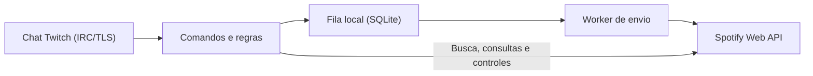

# DangerBotanger

Bot local em Python que recebe pedidos de músicas no chat da Twitch e os envia à fila do Spotify. Possui interface gráfica em Tkinter, execução por terminal e distribuição para Windows.

Versão atual: **0.1.9** · Python **3.11+**. A reprodução exige Spotify Premium e um dispositivo com reprodução iniciada.

## Funcionalidades

- Pedidos por nome, link de vídeo público do YouTube ou link/URI de faixa do Spotify. O áudio é reproduzido pelo Spotify.
- Busca com normalização de títulos e artistas; resultados incertos aguardam confirmação do solicitante por até 60 segundos.
- Permissões por cargo, cooldowns, limites por usuário e fila, bloqueio de duplicatas, usuários, faixas e artistas, além de filtros de duração e conteúdo explícito.
- Consulta da música atual e da fila do Spotify, controles de reprodução e respostas em português brasileiro ou inglês.
- Configuração e autorização OAuth pela interface, renovação automática de tokens e persistência local dos pedidos.

## Comandos

| Comando | Função | Acesso |
| --- | --- | --- |
| `!sr <nome ou link>` | Solicitar música | Conforme a configuração de pedidos |
| `!sim` | Confirmar a própria sugestão pendente | Conforme a configuração de pedidos |
| `!help` | Listar comandos | Todos |
| `!np` / `!song` / `!currentsong` | Mostrar música atual e solicitante, quando identificado | Todos |
| `!queue [página]` / `!fila [página]` | Consultar a fila do Spotify, com 5 itens por página | Todos |
| `!play` / `!pause` | Retomar ou pausar a reprodução | Moderadores e dono do canal |
| `!skip` | Pular a música atual | Moderadores e dono do canal |
| `!volume <0-60>` | Ajustar o volume | Moderadores e dono do canal |
| `!setlang br\|en` | Alterar o idioma das respostas | Moderadores e dono do canal |

As respostas são enviadas como ações `/me`, com menção ao solicitante.

## Arquitetura

A aplicação usa `asyncio` para manter a conexão do chat, o envio de pedidos e o acompanhamento da reprodução em tarefas concorrentes.

| Componente | Responsabilidade |
| --- | --- |
| `app.py`, `gui.py`, `desktop_worker.py` | Inicialização, interface Tkinter e execução das tarefas fora da interface |
| `twitch.py` | Conexão IRC/TLS, identificação de cargos, respostas e reconexão |
| `service.py` | Comandos, políticas de pedidos, worker de envio e monitoramento da reprodução |
| `spotify.py`, `links.py`, `music_titles.py` | Integração Spotify, resolução de links e comparação de títulos e artistas |
| `queue.py` | Persistência dos pedidos, idioma e associação entre reprodução e solicitantes |
| `oauth.py` | Autorização, validação de identidade Twitch e renovação de tokens |
| `config.py`, `settings.py`, `paths.py`, `i18n.py` | Configuração, armazenamento local e mensagens traduzidas |

Os módulos ficam em [`dangerbot/`](dangerbot/). A fila local é uma **outbox**: `pending → sending → sent`. O estado `sent` indica entrega ao Spotify; a reprodução é acompanhada separadamente. Entregas com resultado incerto ficam em `uncertain` e não são reenviadas automaticamente.

Execute uma instância por banco. No código-fonte, os dados ficam na pasta do projeto; no executável Windows, em `%LOCALAPPDATA%\DangerBotanger`. Configurações e tokens são locais. A identificação de quem pediu depende do histórico e das observações do bot.

## Documentação

- [Guia de uso, configuração, regras e desenvolvimento](docs/guia-de-uso.md).
- [Configuração de exemplo](.env.example) e [primeiro uso do executável](COMPARTILHAR.txt).
- [Modelo de especificação para a versão 0.2](docs/especificacao-0.2.md).
- Avaliações de busca: [SR MATCHES 02](docs/sr-matching-evaluation.md) e [SR MATCHES 03](docs/sr-matches03-evaluation.md).
